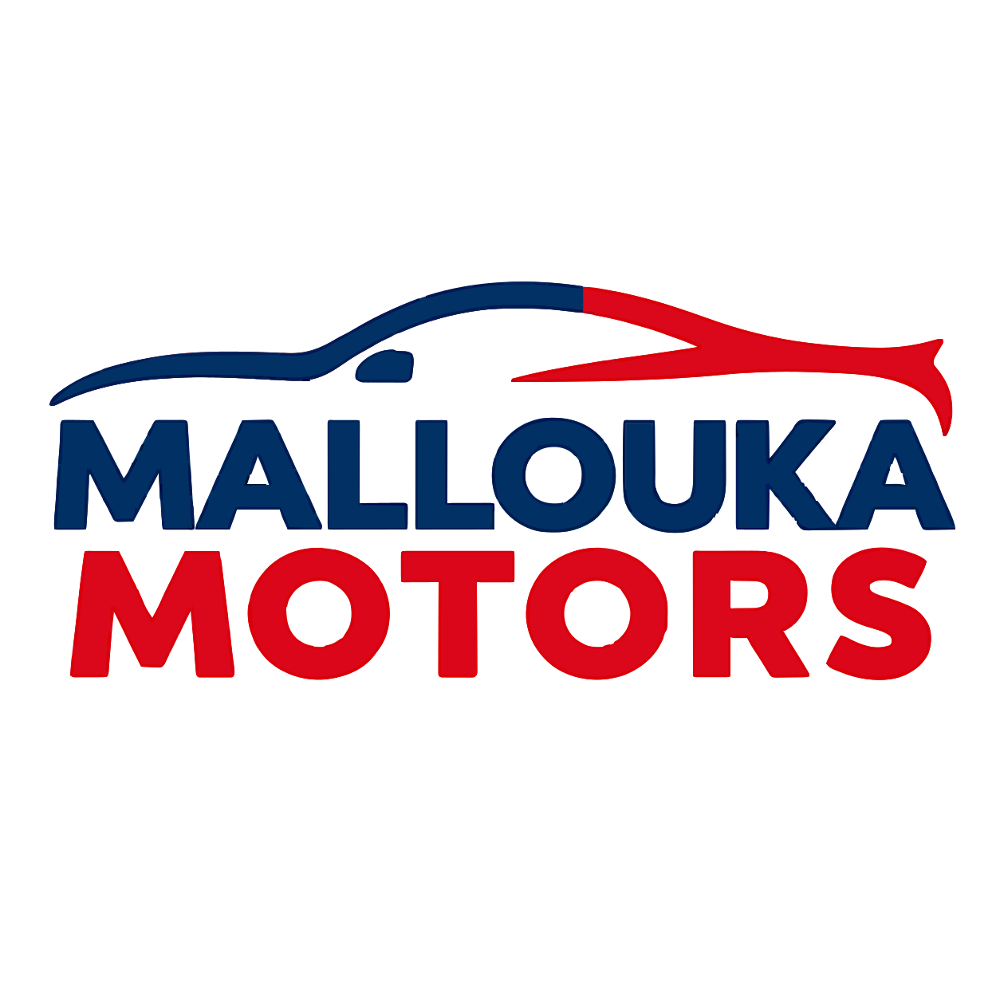
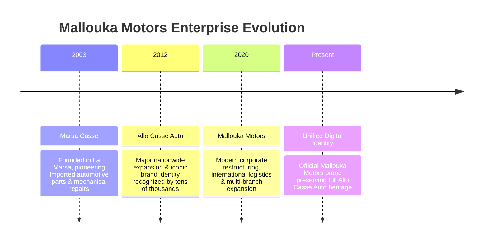
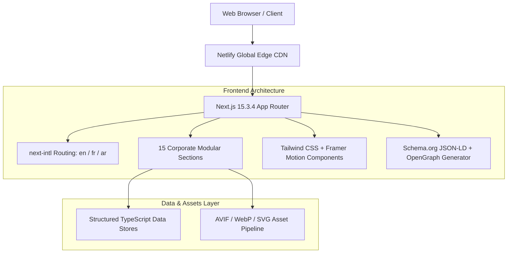

<div align="center">

  

  # Mallouka Motors Official Landing Page
  
  **Tunisia's Trusted Automotive Specialists Since 2003**  
  *Known for years as **Allo Casse Auto***

  <p align="center">
    <a href="https://mallouka-motors.netlify.app" target="_blank">
      
    </a>
    <a href="https://nextjs.org" target="_blank">
      
    </a>
    <a href="https://react.dev" target="_blank">
      
    </a>
    <a href="https://www.typescriptlang.org" target="_blank">
      
    </a>
    <a href="https://tailwindcss.com" target="_blank">
      
    </a>
  </p>

  <p align="center">
    <strong>Languages Supported:</strong> English (<code>/en</code>) • Français (<code>/fr</code>) • العربية (<code>/ar</code> with native RTL)
  </p>

  <p align="center">
    <a href="#-project-overview">Project Overview</a> •
    <a href="#-branding--heritage">Branding & Heritage</a> •
    <a href="#-core-features">Features</a> •
    <a href="#-technology-stack">Tech Stack</a> •
    <a href="#-architecture--directory-structure">Architecture</a> •
    <a href="#-project-sections">Sections</a> •
    <a href="#-enterprise-contact--branches">Contact & Branches</a> •
    <a href="#-author--credits">Author</a>
  </p>

</div>

---

## 🌟 Executive Summary

**Mallouka Motors** (formerly founded as *Marsa Casse* in 2003 and long recognized across Tunisia and North Africa as *Allo Casse Auto*) is a premier automotive enterprise specializing in certified imported engines, gearboxes, electrical components, and automotive spare parts imported directly from European partners (France, Belgium, Germany, Italy, and Spain).

This repository contains the **official corporate landing page and digital showroom** for Mallouka Motors. Engineered with **Next.js 15+ App Router**, **React 19**, **TypeScript**, and **Tailwind CSS**, the platform delivers an ultra-high performance, multi-lingual, and fully accessible web experience engineered to international corporate standards.

- 🌐 **Official Production URL**: [https://mallouka-motors.netlify.app](https://mallouka-motors.netlify.app)
- 🏢 **Official Brand Name**: Mallouka Motors
- 📜 **Historical Public Heritage**: Allo Casse Auto (*"Known for years as Allo Casse Auto"*)
- 📍 **Headquarters**: Bhar Lazreg, La Marsa, Tunis, Tunisia

---

## 🏢 Branding & Heritage Strategy

Over more than two decades, the enterprise evolved across three key milestones:



### Brand Architecture & Design Tokens
The digital presence reflects the company's official corporate identity created specifically for this project:

| Design Dimension | Specification | Usage Details |
| :--- | :--- | :--- |
| **Primary Hue** | `#2d96da` (Pantone Process Cyan tint) | Brand logo, active CTAs, glow orbs, focus rings, link hovers |
| **Secondary Hue** | `#1e293b` (Deep Slate Navy) | Corporate backgrounds, typography contrast, footer surfaces |
| **Accent Hue** | `#f59e0b` (Amber Gold) | Highlights, rating stars, badges, milestone badges |
| **Logo Concept** | High-precision vector emblem | Combines mechanical cogwheel gear with automotive silhouette |
| **Typography** | Dynamic system typography | High-readability sans-serif optimized for LTR and Arabic script |

---

## ⚡ Core Features & Technical Highlights

### 1. Seamless Multi-Language Architecture (i18n & RTL)
- Built on **`next-intl`** with zero-layout-shift routing (`/en`, `/fr`, `/ar`).
- Full Bidirectional Support: Dynamically sets document attributes (`dir="rtl" lang="ar"`) ensuring natural right-to-left flow for Arabic users.
- Clean language toggle switch in the sticky navigation bar preserving current page scroll coordinates.

### 2. High-Performance Media & Asset Delivery
- Next.js Image Optimization utilizing modern **AVIF** and **WebP** formats with responsive srcSets.
- Embedded local MP4 and MOV video showcases optimized with custom posters and lightweight controls.
- Dynamic lightbox modal for visual examination of imported engines, showroom floor, and mechanical equipment.

### 3. Enterprise SEO & Social Graph (CWV-Optimized)
- Complete JSON-LD Structured Data (`schema.org/AutoRepair`) for enhanced Google Rich Snippets.
- Canonical URLs, dynamically generated `sitemap.xml`, and strict `robots.txt` configuration.
- OpenGraph and Twitter Cards metadata pre-configured with multi-lingual fallbacks.

### 4. Interactive & Accessible UI System
- Smooth scroll-triggered reveal animations powered by **Framer Motion**.
- Embla Carousel touch-enabled sliders for brand partnerships and automotive models.
- Accessible form validation driven by **React Hook Form** + **Zod**.
- Interactive Google Maps embed for both enterprise branches in La Marsa and Tunis.

---

## 🛠️ Technology Stack



| Layer | Technology | Version | Purpose |
| :--- | :--- | :--- | :--- |
| **Core Framework** | [Next.js](https://nextjs.org/) (App Router) | `^15.3.4` | Server-side rendering, static site generation, routing |
| **UI Library** | [React](https://react.dev/) | `^19.0.0` | Declarative component architecture |
| **Type Safety** | [TypeScript](https://www.typescriptlang.org/) | `^5.3.0` | Strict static typing across components and data |
| **Styling** | [Tailwind CSS](https://tailwindcss.com/) | `^3.4.0` | Utility-first responsive styling and design tokens |
| **Motion** | [Framer Motion](https://www.framer.com/motion/) | `^11.0.0` | Orchestrated entrance animations and interaction states |
| **Internationalization** | [next-intl](https://next-intl-docs.vercel.app/) | `^3.0.0` | Multi-language translation dictionaries & middleware |
| **Form Handling** | [React Hook Form](https://react-hook-form.com/) + [Zod](https://zod.dev/) | `^7.50` / `^3.22` | Schema-based client form validation |
| **Carousel Engine** | [Embla Carousel](https://www.embla-carousel.com/) | `^8.0.0` | Lightweight touch & mouse drag automotive brand slider |
| **Icons** | [Lucide React](https://lucide.dev/) | `^0.468.0` | Crisp modern vector iconography |

---

## 📂 Architecture & Directory Structure

```
mallouka-landing/
├── animations/                 # Framer motion orchestration variants
│   ├── scroll-reveal.tsx       # Reusable viewport scroll animation wrapper
│   └── variants.ts             # Easing, staggered fades, and hover presets
├── app/                        # Next.js App Router
│   ├── [locale]/               # Dynamic localized route group
│   │   ├── error.tsx           # Localized error boundary
│   │   ├── layout.tsx          # Localized root layout (SEO metadata & Schema.org)
│   │   ├── loading.tsx         # Skeleton loading states
│   │   ├── not-found.tsx       # Localized 404 handler
│   │   └── page.tsx            # Composition entry for all 15 sections
│   ├── globals.css             # Tailwind layers, gradients, and custom scrollbars
│   ├── i18n.ts                 # Request configuration for next-intl
│   ├── layout.tsx              # Root fallback layout with language redirect
│   └── sitemap.ts              # Dynamic XML sitemap generator
├── components/                 # Reusable Atomic & Layout Components
│   ├── layout/
│   │   ├── navbar.tsx          # Responsive navbar with language switcher
│   │   └── footer.tsx          # Corporate footer with branch details & credit
│   └── ui/                     # UI components (Button, GlowCard, Modal, etc.)
├── data/                       # Single-Source-Of-Truth TypeScript entities
│   ├── brands.ts               # 25+ automotive OEM manufacturer data
│   ├── company.ts              # Enterprise metadata, branches, contact points
│   ├── faqs.ts                 # Categorized technical & purchasing FAQs
│   ├── gallery.ts              # Showroom media records, tags, and posters
│   ├── services.ts             # Engine import, diagnostics, and workshop services
│   ├── statistics.ts           # Operational milestone numbers & metrics
│   ├── team.ts                 # Executive leadership profiles
│   ├── testimonials.ts         # Verified domestic & international customer reviews
│   └── timeline.ts             # 2003 -> Present corporate historical records
├── lib/                        # Core utilities & SEO builders
│   ├── seo/                    # OpenGraph, metadata schemas, and canonical builders
│   └── utils.ts                # Tailwind class merge (clsx + twMerge)
├── messages/                   # Translation dictionaries
│   ├── ar.json                 # Arabic localization (RTL)
│   ├── en.json                 # English localization (LTR)
│   └── fr.json                 # French localization (LTR)
├── public/                     # Static production assets
│   ├── assets/
│   │   ├── car-models/         # OEM brand vector logos (BMW, Mercedes, Audi, etc.)
│   │   ├── company/            # Showroom photography and MP4 video tours
│   │   ├── logo/               # Vector SVG logo & Allo Casse Auto historical asset
│   │   └── team/               # Executive leadership portraits
│   ├── og-image.png            # 1200x630 Social Graph banner
│   └── robots.txt              # Production web crawler directives
├── sections/                   # 15 Self-Contained Landing Page Sections
│   ├── hero.tsx                # Hero banner with primary CTAs
│   ├── brands.tsx              # Infinite scrolling marquee of car manufacturers
│   ├── statistics.tsx          # Animated number counters
│   ├── about.tsx               # Enterprise vision, mission, and values
│   ├── timeline.tsx            # Interactive historical timeline (2003-Present)
│   ├── services.tsx            # Comprehensive breakdown of company capabilities
│   ├── process.tsx             # 4-stage engine sourcing & import lifecycle
│   ├── why-choose.tsx          # 8 core enterprise value propositions
│   ├── workshop.tsx            # Dedicated mechanical workshop showcase
│   ├── gallery.tsx             # Filterable photo & video showroom lightbox
│   ├── testimonials.tsx        # International client reviews (Tunisia & France)
│   ├── team.tsx                # Leadership presentation (Owner & GM)
│   ├── faq.tsx                 # Searchable accordion FAQ
│   ├── contact.tsx             # Direct inquiry form with validation
│   └── maps.tsx                # Dual interactive Google Maps embeds
├── middleware.ts               # Locale negotiation and redirect middleware
├── next.config.js              # Image remote patterns, security headers & i18n
├── tailwind.config.ts          # Custom color palettes, shadows, and animations
└── tsconfig.json               # TypeScript strict compiler options
```

---

## 📑 Detailed Page Sections Breakdown

The landing page features **15 meticulously crafted sections**:

1. **Hero Section (`sections/hero.tsx`)**: High-impact banner introducing Mallouka Motors with immediate recognition of the historical Allo Casse Auto identity, direct WhatsApp CTA, and quote request button.
2. **Brands Marquee (`sections/brands.tsx`)**: Infinite fluid animation displaying 25+ major automotive OEM brand marks (Mercedes-Benz, BMW, Audi, Volkswagen, Renault, Peugeot, Toyota, etc.).
3. **Key Statistics (`sections/statistics.tsx`)**: Dynamic counting counters showcasing 20+ years of operation, 2,500+ engines imported, 10,000+ satisfied clients, and European supply routes.
4. **Corporate About (`sections/about.tsx`)**: Articulates the company’s vision, founding principles, European sourcing standards, and core commitment to quality.
5. **Interactive Timeline (`sections/timeline.tsx`)**: Chronological visual guide showing the transition from *Marsa Casse (2003)* $\rightarrow$ *Allo Casse Auto (2012)* $\rightarrow$ *Mallouka Motors (2020–Present)*.
6. **Services Suite (`sections/services.tsx`)**: Detailed cards covering engine sales, manual/automatic gearboxes, electronic control modules (ECUs), and spare parts.
7. **Importation Process (`sections/process.tsx`)**: 4-step transparency workflow: Sourcing in Europe $\rightarrow$ Technical Testing $\rightarrow$ Maritime Logistics $\rightarrow$ Warranty & Client Delivery.
8. **Why Choose Us (`sections/why-choose.tsx`)**: Competitive advantages including guaranteed compression tests, genuine provenance, and warranty coverage.
9. **Mechanical Workshop (`sections/workshop.tsx`)**: Presentation of the specialized mechanical mounting and maintenance workshop located in El Bahr, Tunis.
10. **Multimedia Gallery (`sections/gallery.tsx`)**: Filterable media grid featuring interior showroom photography, exterior warehouse footage, and high-definition walkthrough videos.
11. **Testimonials Carousel (`sections/testimonials.tsx`)**: Real verified reviews from long-time customers and business partners across Tunisia and France (Toulouse, Paris, Sfax, Tunis).
12. **Executive Leadership (`sections/team.tsx`)**: Professional profiles of founder **Majdi Feki** and general manager **Rochdi Feki** with direct communication links.
13. **Frequently Asked Questions (`sections/faq.tsx`)**: Interactive accordion covering engine warranties, delivery timelines, and compatibility checks.
14. **Contact & Quote Form (`sections/contact.tsx`)**: Validated contact form paired with real-time telephone and WhatsApp quick-dial capabilities.
15. **Branch Locations (`sections/maps.tsx`)**: Embedded Google Maps with pinpoints for both operational branches in La Marsa and Tunis.

---

## 🚀 Getting Started Locally

### Prerequisites
- **Node.js**: `v18.18.0` or higher (Node 20+ recommended)
- **npm** or **pnpm** installed on your system

### Installation & Execution
```bash
# 1. Clone the repository
git clone https://github.com/fekikarim/mallouka-landing.git
cd mallouka-landing

# 2. Install dependencies
npm install

# 3. Launch development server
npm run dev

# 4. Open in browser
# Accessible at: http://localhost:3000 (auto-redirects to /fr or /en)
```

### Production Build
```bash
# Create optimized production build
npm run build

# Start local production runtime
npm run start
```

---

## 🏢 Enterprise Contact & Locations

| Location / Channel | Information | Direct Action |
| :--- | :--- | :--- |
| **Branch 1: Spare Parts & Engines** | Rue Ibn El Jazzar, Bhar Lazreg, La Marsa, Tunis 2046 | [Open in Google Maps](https://maps.app.goo.gl/Hrv1fa1jRtX3vc4y9) |
| **Branch 2: Mechanical Workshop** | Rue Jaber Ibn Hayen, El Bahr, Tunis 2070 | [Open in Google Maps](https://maps.app.goo.gl/6d4xHMM6T7qcaji78) |
| **Customer Support Phone** | `+216 24 270 888` | [Call Support](tel:+21624270888) |
| **Direct WhatsApp Inquiries** | `+216 44 511 011` | [Chat on WhatsApp](https://wa.me/21644511011) |
| **Official Email** | `malloukamotors21@gmail.com` | [Send Email](mailto:malloukamotors21@gmail.com) |
| **LinkedIn Company** | `company/mallouka-motors` | [View LinkedIn](https://www.linkedin.com/company/mallouka-motors) |
| **Facebook Official** | `@Mallouka.motors` | [View Facebook](https://www.facebook.com/Mallouka.motors) |
| **Instagram Official** | `@Mallouka.motors` | [View Instagram](https://www.instagram.com/Mallouka.motors/) |

---

## 👤 Author & Credits

This project was conceived, designed, and engineered exclusively by **Karim Feki** as the official digital flagship for **Mallouka Motors Entreprise**.

| Avatar | Name | Role | Links |
| :---: | :--- | :--- | :--- |
|  | **Karim Feki** | Full Project Conception, End-to-End Development, Architecture, Corporate Branding & Logo Creation | [GitHub](https://github.com/fekikarim) • [LinkedIn](https://www.linkedin.com/in/karimfeki) • [Portfolio](https://karimfeki.is-a.dev) |

---

## 📄 License & Rights

Copyright © 2003–2026 **Mallouka Motors** (formerly *Allo Casse Auto*). All rights reserved.  
All brand trademarks, vehicle logos, and corporate emblems displayed on this platform are the registered intellectual property of their respective manufacturer OEM entities.
